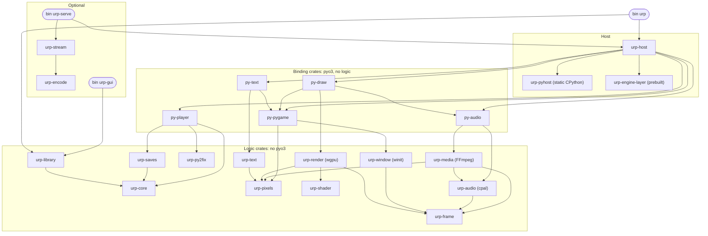

# urp redo: analysis report

Nothing in the repository was changed, built or run. Sources: six evidence briefs (`docs/redo/evidence-*.md`), three max-reasoning analyses (`docs/redo/analysis-product.md`, `docs/redo/analysis-architecture.md`, `docs/redo/analysis-test-build.md`), the audit (`docs/redo/audit-findings.md`) and the untangle log (`docs/redo/untangle-decision-log.md`). Claims marked "checked" I verified against the source myself.

## 0. Owner decisions (2026-11-12). These supersede any recommendation below that differs.

| Topic | Decision |
|---|---|
| Route | Rust host that owns its frames. Ren'Py 7 in scope. macOS arm64 and Linux x86_64 through Nix only. Ren'Py pinned at 8.5.3. pyo3 on static CPython 3.12.8 stays. |
| Redo mode | Greenfield, in a new top-level tree beside `player/`. Pure logic may be lifted if it arrives with tests. Host, boot, lifecycle, bindings, window model, build and the manager boundary are written new. |
| Old tree | Reference and fixture generator. Deleted after the new loader passes the real-game gate on the 23-game corpus on the Mac and artemis (N4). |
| Thin Python | Scheduled Rust ports behind the same Python API, after the restructure, not gated on a profile: loader and image cache policy, then audio manager, then text layout. A frame profile runs first as information only. |
| Product split | The loader `urp` knows nothing about the library: it takes a game path and a launch record and emits typed status events. A separate manager system in the same repository (library, CLI, mods, import, RAR, GUI) builds the record and invokes the loader. Streaming and GUI are optional binaries. |
| Mods, import, RAR | Kept, in the manager. Mods reach the game through a manager-built merged directory if a 1 day spike proves it on both platforms; fallback is the runtime file layer. |
| Cut | Background warm-up, patch 0016, AI upgrade pass and deep-run campaign tooling, `sw` renderer. |
| Parked | Port patches, patches 0012 and 0018. |
| Speed goal | Video is the only hard bar. Startup and scene change: not slower than stock. |
| Oracle | Fixtures captured from today's binary before any new code, plus goldens generated once from stock. Stock differential weekly and per release. Real GPUs and real games per release. |
| Harness | New small runner for the headless golden tier through the automation interface. Today's harness kept for the stock differential and real-game tiers, reduced after N4. |
| Data | Fresh data folder. No compatibility with today's key format, saves layout or mods layout. |
| Before the redo | Five small fixes (section 10) and the CI quick wins (section 6) on today's code. |
| During implementation | Remove comments that only restate the code. Remove tests that would not catch a real bug, and fix the ones that fail without one. |

Milestones: N0 build artefacts, skeleton, dependency checks, test tiers. N1 headless Ren'Py 8 synthetic game matches goldens. N2 windowed play on macOS and Linux with audio and hardware video. N3 Ren'Py 7. N4 real-game gate. N5 manager (library, CLI, mods, import, RAR, then GUI). N6 streaming. N7 the Rust ports.

Superseded text in this report set:
- Section 3: mods, archive import and RAR are kept (manager), not deferred or cut.
- Section 4: ports are scheduled, not gated on a 10 percent profile threshold.
- Section 5: redo mode is greenfield, not hybrid. Stages S0 to S6 are replaced by N0 to N7; S0's fixture capture still comes first. The crate diagram gains a manager system that owns `urp-library`; `bin urp` no longer depends on it.
- `analysis-product.md` scope B, `analysis-architecture.md` sections 4 and 9.3 (A3, A4, A7), and `untangle-decision-log.md` where they park mods or the file view.
- `audit-findings.md` C6 rule 2 ("key format and saves layout are frozen"): void. The data folder starts fresh; `DataLayout` still has one owner.
- Audit findings marked "moot if cut" for mods (S09-R1, S18-R1) apply again. S17-R2 (warm-up lock) stays moot.

## 1. What the project is today

- 681 commits in six weeks, 440 of them in five days. 170 are fixes. About 40k lines of Rust in 15 crates, 8k lines of project Python, 27 fuzz-0 patches on Ren'Py 8.5.3, 7k lines of harness.
- Problems 1 to 3 of the original map (version drift, duplicate engines, per-platform copies) are solved and gated on 23 real games. LAN streaming works on Mac and Linux.
- "Faster than stock" is proven for one case: 4K 10-bit video, in an unmerged prototype. Cold scene change was never measured. Startup numbers mostly compare player against player.
- The product then grew sideways with no recorded decision: mods, archive import with RAR, background warm-up, an egui manager, parallel compile, an AI upgrade pass. 8 of the 14 audit bugs filed on 2026-11-04 are lifecycle bugs in that growth.
- The thin-Python goal ("strangler") never started. No profile of the Python share of a player frame exists.

## 2. Why the loop is heavy

| Cost | Size | Kind |
|---|---|---|
| PR critical path | about 38 min (Linux build 14m45s, then synthetic games 23m30s) | |
| Tests themselves | about 13 s (111 Rust tests in 5 s, 79 Python tests in 8 s) | |
| CPython, FFmpeg, static deps rebuilt on a cache-key miss | 569 s | accidental |
| Engine layer rebuilt on every CI run (stamp deleted, checked: `container-build.sh:175`) | inside the build | accidental |
| Stock Ren'Py baselines re-run every time | about half of the synthetic job | accidental |
| Release-profile, workspace-wide test build | 63 s compile for 5 s of tests | accidental |
| Two Nix variants on two platforms per push to main | about 48 runner minutes | accidental |

Root cause: 10 of 15 crates link pyo3, `library` carries the GUI, `surface` drags FFmpeg into `text` and `gfx`, and cargo build scripts build CPython and the engine. So no logic can be tested without the whole product. About 19,500 lines (gfx, surface, text, saves, vfs, media) have 0 to 2 tests each.

## 3. Product scope (decided and recommended)

Decided by you: keep the Rust host and own the frames; Ren'Py 7 stays; private first, macOS arm64 and Linux x86_64 through Nix only.

Recommended, not yet confirmed:

| Verdict | Features |
|---|---|
| Core | Play Ren'Py 8 and 7 from `game/`; wgpu renderer; FFmpeg video with hardware decode; Rust text and image loading; winit platform layer; headless mode; stock save import and detector; pre-flight report; library data and CLI; patches 0011, 0013 to 0015, 0019 |
| Optional binary | LAN streaming (about 5,250 lines, about 100 lock packages, two native builds); library GUI (2,650 lines, its own wgpu and egui stack) |
| Deferred | Mods and the vfs; archive import; port patches; lazy compile 0012 and tl deferral 0018; Windows; AppImage and manylinux |
| Cut | RAR; background warm-up; parallel compile 0016; AI upgrade pass; `sw` renderer (cannot present); Windows test kit; `linux.sh` |
| Reworded goal | "Faster than stock" becomes: real-time 4K 10-bit video, and not slower than stock on startup and scene change |

Effect: about 5.4k lines deleted, about 5.9k parked, about 7.9k optional. The default build drops by about 19k lines.

## 4. The thin-Python goal: what is reachable

You said the plan was a performant Rust layer and a very thin Python layer. The evidence limits that:

- Ren'Py's runtime is 58k lines of Python and 23k of Cython. About 45k lines of Python plus 20.6k of `renpy/common` must stay on any route. Reasons: saves and `.rpyc` files pickle engine class names (17,741 real saves name 162 `renpy.*` classes), games subclass engine classes (4,439 game classes in saves), creator-defined statements receive the Python `Lexer`, and `renpy.ui.interact()` blocks inside game Python (checked), so the game state lives on the Python stack.
- The three measured pains (video, image decode, renderer) were native, and are already in Rust. No measurement shows Ren'Py's Python as a user-visible cost.
- pyo3 is the right binding and the code already uses it (0.29, static CPython 3.12.8). "pyo2" does not exist. RustPython measured 7 to 12 times slower and cannot load Cython modules; PyPy cannot embed; subinterpreters are refused by five Cython modules.

Reachable definition of thin: the project owns about 5k lines of Python instead of 7.6k; no Python runs per pixel, sample or glyph; one draw crossing per frame; a measured per-frame Python budget. Ren'Py subsystems move to Rust one at a time only when a profile shows 10 percent or more of a frame or phase.

## 5. Target architecture: narrow waist

Ren'Py's Python stays whole. Rust owns everything below it behind three data-only seams: one display list per frame, an input event batch, audio and video queues.

Rules: a logic crate has no pyo3 in its dependency tree, enforced by a check. One binding crate per Python module family; a binding function converts, releases the GIL, calls one logic function. Only `urp-pyhost` emits link lines.

State models replaced:

| Today | Replacement |
|---|---|
| Headless as two global flags plus env reads | `RunMode { Windowed, Headless }` in one immutable `LaunchSpec` |
| One window held three times, six free booleans | One `WindowState` owned by `urp-window` |
| Global frame sink and PCM tap, one slot each | Typed taps fixed when the host is composed |
| Untyped `settings` dict, about 29 env vars, `unsafe set_var` | `LaunchSpec` built once in Rust, exposed to Python as a frozen object |
| Hooks hung on `path_to_common` and `path_to_saves` | Named phases: `EngineImported`, `ScriptLoaded`, `InitDone`, `Quit` |
| Game key, data dir and Ren'Py 7 detection in Rust and Python | Derived once in `urp-core` |
| 27 patches, 7 stacked on `script.py` | A series with a manifest, squashed per file and group: 24 patches, 4 on `script.py` |
| `BUILD_FINGERPRINT` hashes tests and all of `_player` (checked: `build.py:154`) | Narrow `ENGINE_ABI` cache key, with a guard test |

Redo mode: hybrid. New workspace skeleton with enforced rules; existing crates ported in one at a time; host, boot, the display-list seam and the window model written fresh. A greenfield rewrite would discard the behaviour knowledge behind 170 fix commits, and there are almost no unit tests to recover it from.

Stages, each ending with a working player:

| Stage | Content |
|---|---|
| S0 | Capture fixtures from today's binary (headless frames, translated shaders, glyph hashes). Apply cuts. Run the profiles |
| S1 | New skeleton and pure crates. GUI and streaming leave the default build |
| S2 | Host lifecycle: `LaunchSpec`, phases, one key, one detection, narrow cache key |
| S3 | Split logic from bindings in pixels, text, audio and media, window |
| S4 | Display-list waist. `wgpudraw.py` shrinks from 1,529 lines to a shim |
| S5 | Patch series cleanup (can run beside S2 to S4) |
| S6 | Profile-gated moves of Ren'Py subsystems to Rust |

## 6. Build and test design

Native inputs become Nix derivations that cargo reads through env vars and never builds: CPython, FFmpeg, the Cython archive, a test interpreter (`urp-enginepy`: CPython plus the Cython modules, no Rust), the patched tree, the common and layer zips. One CPython recipe replaces five; one FFmpeg source replaces three.

| Tier | Proves | Needs | Target (estimate) | Runs |
|---|---|---|---|---|
| T0 | Pure logic | Rust toolchain | under 10 s for one crate, under 3 min all | pre-commit, PR |
| T1 | Each binding module | static CPython artefact | under 3 min | PR |
| T2 | Patches, parser, compat on real Ren'Py code | `urp-enginepy`, no cargo build | under 1 min | PR |
| T3 | Decode, shaders, render at crate level | FFmpeg, lavapipe | under 3 min | PR |
| T4 | Whole player, headless, synthetic games against committed goldens | dev-profile `urp`, lavapipe | under 6 min in 3 shards | PR |
| T5 | Goldens still equal stock | stock SDKs | 25 to 30 min | weekly, release |
| T6 | Real GPUs, real games, streaming | Mac, artemis | hours | release |

PR target: under 10 min wall on Linux, against about 38 min today. Ren'Py 7 test inputs (Python 2 `.rpyc` and saves) are generated once on Linux and committed, so Rosetta and the 7.4.11 SDK leave the loop.

Quick wins that need no re-architecture (estimates):

| # | Change | Critical path after |
|---|---|---|
| Q1 | Stop deleting the engine stamp; cache the engine build; fix cache keys | about 30 min |
| Q2 | Reuse stock baselines (`--baseline-root` exists, unused) | about 18 min |
| Q3 | Shard the synthetic job by game | about 11 min |
| Q4 | Cache push on tags only, one variant | 101 to 53 runner minutes per main push |
| Q5 | Move tests out of the fingerprinted tree | test edits stop invalidating user caches |
| Q6 | A fast pure-test job and local command | first signal in about 2 min |
| Q7 | Drop Windows and manylinux from PR CI | about 9 to 10 min |

## 7. Defects that matter regardless of the redo

1. Linux AppImage and Windows zip lack the CPython `__get__` patch that Ren'Py 7 games need (checked: no patch step in `container-build.sh` or `build_windows.py`). The test for it always skips.
2. The Linux package FFmpeg is built without libopus (checked: `container-build.sh:150-152`), so `urp serve` from it very likely streams with no audio. Not run.
3. A changed CPython patch leaves a stale libpython: the build keys on the existence of a stamp file (checked: `pyhost/build.rs:35`).
4. Any player update recompiles every game for every user (fingerprint scope).
5. #96: a port patch with no sidecar counts as trusted.
6. #107: any LAN client can take over a stream session.
7. #100, #101, #105, #106: save import latch, stale pid SIGTERM, scan child crossing runs, unreaped compile workers.
8. Library rescan drops a folder that is not mounted, and saves that.
9. Docs claim Windows hardware decode, a "skip save signature" setting and a Ren'Py 7 override. None exists.

Full list: `docs/redo/analysis-product.md` section 6.

## 8. Spikes before committing

| Spike | Cost (estimate) | Question |
|---|---|---|
| SP1 | 1 to 2 days | What share of a player frame is Ren'Py Python, native code, GPU wait |
| SP2 | 0.5 day | Is the cold scene change really 10 to 30 ms |
| SP3 | 1 day | How many library games touch engine internals |
| SP4 | 2 to 3 days | Can a display list replay frames in a Rust-only test |
| S2 (test) | 0.5 day | Does the test interpreter import dotted builtins and compile `renpy/common` |
| S4 (test) | 0.5 day | Are in-engine stock frames and lavapipe frames stable enough for goldens |

## 9. Note

The repository is public on GitHub (checked with `gh repo view`). "Private first" therefore describes the audience, not the repo, and hosted runner minutes are not a cost constraint.

## 10. Audit and untangle results, and what they change in the design

The audit covered 31 subsystems: 29 findings in 20 subsystems, 11 skips. I verified every finding at its cited lines; one was narrowed (the mod order miscount does not occur, only the duplication does). The untangle log lists 46 hidden links, 26 needless links, 17 surplus items and 66 special cases, solved by 12 fixes. Both agree with the architecture analysis on the main moves, which were reached independently.

Five patterns account for most findings:

| Pattern | Seen in | One representation that removes it |
|---|---|---|
| Run mode travels as global flags, env vars and singleton slots | 9 subsystems | One immutable `LaunchSpec` with a mode enum, built in Rust |
| One fact derived in several places (key, data dir, Ren'Py 7, about 20 hand-built data paths, save scan, three engine start sequences) | 7 facts | One pure `core` crate with `GameId`, `DataLayout`, `GameProfile` |
| Closed vocabularies cross file seams as free strings | 6 subsystems | Enums on both sides, unknown is an error |
| Failure stored as a bool latch that reads as success or permanent off | 6 subsystems | Failure is a state variant with data; default arm denies |
| Build and cache identity keyed on the wrong inputs | 4 subsystems | Content hash of declared inputs; separate cache format id |

Changes to the target design in section 5:

1. Feature slices own their vertical. `compat7`, `saves`, `script-load`, `images` each hold their pure crate, binding, Python glue, engine patches and tests in one folder. A slice depends on `core` and the hook API, never on another slice. Cutting or deferring a slice removes its patches in one step. This replaces the flat patch list with ownership.
2. A separate pure `pickle` crate (opcode decoder), so `urp-library` does not depend on the save detector.
3. One process contract: a launch mode goes in, typed status events come out on a pipe. This removes three stdout-scraping protocols and four re-exec chains.
4. A declared automation interface replaces `--harness-script`. The product never names the harness; the harness never imports `_player` internals. Player-side checks read the player's own frames offscreen, so they need no window, compositor or machine lock.
5. One version manifest for Ren'Py, CPython and wheels, read by Nix, build scripts, the save detector and the harness.
6. Binding crates stay one per module family. The audit proposed a single binding crate; that would link wgpu and FFmpeg into every binding test.

Volatility evidence for the dependency rules: the harness is the most-changed code (238 of 681 commits), then `CONTRACTS.md` (51), `library` (39). 14 dependency edges point from stable code to volatile code today; the worst are game boot depending on the GUI crate, the user cache key depending on test files, and the shipped binary naming the harness.

Fixes worth doing before any redo (small, protect data or trust in the gate):

| Fix | Where |
|---|---|
| A save-resolver error must fail the import instead of marking saves loadable | `crates/saves/src/lib.rs:47-68` |
| Split the cache key from the build id; move tests out of the hashed tree | `engine/build.py:150-157` |
| Unknown deep-run end reasons must fail; run `harness/tests` in CI | `harness/gatelib/deep.py:210-222` |
| `rescan` must keep a folder that is not mounted | `crates/library/src/config.rs:134-146` |
| CPython stamp carries the recipe hash | `crates/pyhost/build.rs:35` |

No fix exists, by design of the route: the patch stack against upstream text, the pygame-shaped API surface (about 110 functions), `wgpudraw.py` as a port of `GL2Draw`, and the raw function pointers for audio filters.
