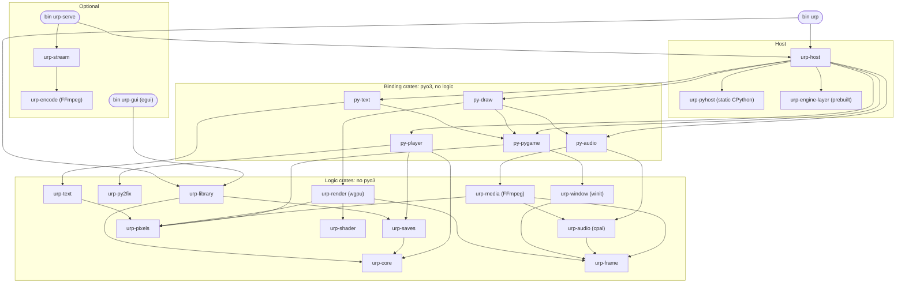

# Architecture analysis for the `urp` redo (seam, crates, state, migration)

Source tags: [H] evidence-host-boundary, [R] evidence-render-media, [L] evidence-library-compat, [S] evidence-streaming, [T] evidence-test-build-cost, [G] evidence-goals-decisions, [C] evidence-crate-graph, [P] analysis-product. `§` is the section in that brief. Research sheets are cited as `anatomy`, `boundary`, `embedding`, `perf`, `script-load`, `savecompat`, `drift`, `pypack` with line numbers. `[count]` marks a number I produced with a read-only `rg`/`wc` over `player/upstream/renpy-8.5.3` or `player/crates` on 2026-11-12. [INFERENCE] marks anything unverified. Nothing was built or run.

Assumption flags used below: **[As-opt]** streaming and GUI are optional binaries. **[As-defer]** mods, archive import and port patches are deferred; RAR, warm-up, 0016, AI upgrade and `sw` are cut. **[As-parity]** stock-frame parity is a release tier. **[As-pin]** Ren'Py stays at 8.5.3. None is confirmed by the owner.

**Conclusion.** Keep Ren'Py's Python layer whole. Move everything below it behind three data-only seams (frame, input, audio/video), and put all Rust logic in crates that do not link Python. "Very thin" is reachable for the Python the project owns and for Python time per frame. It is not reachable for Ren'Py's own 58k lines without breaking saves and games. Redo as a hybrid: new workspace skeleton, crates ported in one at a time, host lifecycle rewritten, engine Python and patches restructured in place.

## 1. The Python floor

### 1.1 What must stay Python on any route, and why

| Item | Why it cannot leave CPython | Evidence |
|---|---|---|
| Game Python | `.rpyc` stores Python as source text. It is compiled at load through `WrapNode` AST rewriting, then `compile(tree)`. This needs CPython 3.12 `ast`, `compile`, `marshal`. | embedding:27-33, 40-47 |
| Store and rollback | `RevertableList/Dict/Set` subclass the builtins. `StoreDict` is a `dict` subclass used as `exec` globals. Rollback keys on `id()` and `weakref`, and walks arbitrary game objects with `vars()`. | embedding:49-57; anatomy:27 ("very weak seam") |
| Pickled class names | `.rpyc` is a pickle of `renpy.ast` classes in two layouts (dict, cslots tuple). Saves pickle the rollback log and store. 17,741 real saves name 162 distinct `renpy.*` globals: 150 in pure-Python modules, 13 in native ones. `Style` is in 17,737 saves, `Matrix2D` in 17,155. 4,439 distinct `store.*` game classes. Old paths such as `renpy.python.RollbackLog` must resolve. | drift:14-17; savecompat §2 and `results/census_aggregate.txt`, `native_classes.txt` |
| `renpy.*` API | 213 top-level functions in `renpy/exports/` [count], about 487 `config` variables [count, regex], plus the default store. Games call all of it. | anatomy:25, 37 |
| Custom displayables | Games subclass `renpy.Displayable` and build `Render` trees in Python `render()`. The display core "is the game API", not a seam. | anatomy:30 |
| Creator-defined statements | `register_statement` parse callbacks receive the Python `Lexer` (`lexer.py:722`; `match`, `word`, `simple_expression`, `subblock_lexer`, `require`). A Rust lexer was rejected because the parser calls the lexer from 100 or more methods. | script-load:169; [count] |
| Screen language and ATL runtime | `sl2/slast.py` (2,762 lines [count]) evaluates store expressions on every interaction. | anatomy:30 |
| `renpy/common` | 18.1k lines of Ren'Py script plus 1.6k Python, run by the interpreter. It holds 228 Python class definitions and 73 references to engine internals such as `renpy.game.*` and `renpy.display.interface` [count]. Any engine that does not run Ren'Py's interpreter must satisfy it. | anatomy:40 |
| `00compat` cascade | Old-game behaviour is restored by `config.*` flags that are implemented inside the Python layout, transform and text code. | drift:25-30 |
| Ren'Py 7 module (D2) | urp's own compat module hooks `wrap_node`, `py_compile`, loader callbacks, `config.exception_handler`, rollback, `ui.reset`, `layout`, `savetoken`. D2 therefore pins these internals in Python. | [L§7] |
| Blocking `interact` | `renpy.ui.interact()` is called from inside game Python (`exports/actionexports.py:81`, `menuexports.py:418`, `inputexports.py:57`). The game's state lives on the Python stack. A Rust main loop cannot call "one frame of Python" without a second thread. | [count]; `display/core.py:2108` |

### 1.2 Upstream size by subsystem, classified

Code lines from `research/engine-anatomy/loc-by-subsystem.md` (tokei). Runtime engine: 58.0k Python, 23.4k Cython, 23.6k C.

| Subsystem | Py / Cy / C | Class | Note |
|---|---|---|---|
| AST, script load, interpreter, exports | 13.0k / 0.1k / 0 | Must stay Python | Pickle names, `PyCode`, game API |
| Lexer and parser | 4.1k / 0 / 0 | Must stay Python | CDS callbacks get the `Lexer` object |
| Rollback, store, Python exec | 3.8k / 0.4k / 0 | Must stay Python | Cython `pydict`, `cslots` already native |
| Save, load, persistent | 2.1k / 0 / 2.9k | Must stay Python | Zip container and detector are already Rust (`saves`) |
| Display core, layout, screens, behaviours | 22.3k / 0 / 0 | Classes must stay Python. Inner algorithms can move behind the same class API, with a profile | 145 classes in `display/*.py`, 40 in `sl2`, 65 `render()` and 38 `event()` methods [count] |
| Text layout (`text.py`, `font.py`) | 3.5k / 3.1k / 0.7k | Can move behind the same API | Font backends are already Rust (`text`). `textsupport`, `texwrap` are kept Cython |
| Audio manager (`audio.py`) and video glue | 2.6k / 1.2k / 2.0k | Can move behind the same API | `renpysound` is already Rust (`media`). `filter.pyx` is kept Cython and pickled |
| Asset loader, image cache policy | 2.5k / 0 / 0 | Can move behind the same API | Decode pool is already Rust |
| Render tree core | 0.8k / 3.0k / 0 | Already native (Cython, kept) | `Render`, `Matrix` are game-visible and `Matrix2D` is pickled |
| GL2 renderer | 1.0k / 6.7k / 0 | Already replaced by Rust | Plus 1,529 lines of new Python (`wgpudraw.py`) and 802 of new Cython [R§1] |
| pygame layer | 0.7k / 8.0k / 11.1k | Already replaced by Rust | Plus about 1.0k pure-Python stand-ins (rect, color, rwobject) [H§1] |
| Style | 0.2k / 0.6k / 0 | Already native (Cython, kept) | In nearly every save |
| Platform glue, config | 1.4k / 0.2k / 6.8k | Stay | `config` is game surface |
| `renpy/common` | 1.6k Py + 18.1k `.rpy` | Must stay | |

Totals: 23.0k Python must stay. 22.3k must stay as classes. 12.7k could move behind the same API in principle. Kept Cython is about 10.8k source lines across 21 modules (boundary §2.1, summed [count]). It is already compiled C. Porting it to Rust buys no speed and puts `Style`, `Matrix2D` and `PyExpr` pickles at risk.

### 1.3 How thin "very thin" can honestly get

- **By lines of Ren'Py Python: not thin.** After every plausible move, about 45k lines of engine Python and 20.6k of `renpy/common` still load. The ceiling of the strangler is the 12.7k "can move" lines plus inner loops of the display core. The class shells, their names and their pickle shapes stay.
- **By lines the project owns: yes.** Today the project owns about 7.6k lines of non-test Python: `_player` 4,138, overrides 1,918, `wgpudraw.py` 1,529 [H§1], [R§1]. The target is about 4.7k: compat 2.2k (it is an AST pass over CPython `ast`, so it stays Python), boot and hooks 0.4k, pre-flight 0.25k, data stand-ins 1.5k, draw shim 0.4k [INFERENCE on the target sizes].
- **By time and ownership: yes, and this is the definition I recommend.** Python owns no native resource. No Python runs per pixel, per sample or per glyph. One boundary crossing per frame for drawing. Python time per frame is measured and budgeted.

Push-back on the owner's wording: "performant Rust layer, very thin Python layer" describes route (a), which the record rejected with evidence (anatomy:62, [G§2.1]). The measured pains were native-side and are already moved (section 2). No profile shows Ren'Py's Python as a user-visible cost on the owner's hardware.

### 1.4 What games do that blocks thinning

- They subclass engine classes and the subclasses are pickled: 4,439 `store` classes in saves (savecompat §2).
- They ship their own Python modules that end up in saves: `pink_engine.*` (25 classes), `filtered_image` (savecompat `resolve_census.txt`).
- They replace engine internals at `python early`. A probe replaced `renpy.python.wrap_node` and `renpy.compat.fixes.fix_tokens` from a game file on 8.5.3 and it worked (`research/py2compat-facts/README.md:93`). urp's compat module uses the same door.
- They read undocumented `renpy.display.*` internals (drift:55). **How many do is not measured.** My check of the two games on this Mac found one `renpy.display.` reference in 56 loose `.rpy` files [count]. That sample is too small to conclude from. Spike SP3 settles it.

## 2. Where the time goes

| User-visible cost | Stock measurement | Side | Status in urp |
|---|---|---|---|
| 4K 10-bit and 4:4:4 video | 8 fps at 3.4 cores, 23 fps at 1.9 cores (perf:61-64) | Native: FFmpeg software decode and swscale C paths (perf:74-76) | Fixed by Rust media and GPU YUV. 60 fps at 0.2 cores in a prototype, not in the player on those files [G§3.3] |
| Ordinary video per-frame overhead | About 0.4 core of zeroing, conversion and copies at 4K (perf:77) | Native | Fixed by the same path |
| Cold scene change | 68-106 ms at 1080p, 265 ms at 4K, all in `final predict` (perf:87-98) | Native decode, driven synchronously from Python | Rust decode pool and patches 0100-0103 exist. **End to end never measured** [G§3.3] |
| Cache thrash on revisit | 400 MB default cache too small (perf:99) | Policy in Python | Patch 0103 sizes from GPU memory, Metal only [R§4] |
| Startup, script load | 0.5-2.1 s warm, plus 1-3 s cold (perf:107-117) | Python: unpickle, compile, and parse at 76 percent of a lazy cold load (script-load:169) | 0011 (138 s to 3 s), 0012, 0013, 0014, 0019, build-time `common.rpyc` [H§4]. Warm urp 0.8-0.9 s against stock 1.3-2.5 s on one game (script-load:12) |
| Init code | 0.1-0.4 s (perf:109-115) | Game Python | Not addressable |
| Save and load | 15-70 ms. AstralLust 141-172 ms (perf:125-128) | Python pickle of game state and the pure-Python `reached` walk (embedding:56) | Unchanged. Not measured in the player |
| Steady-state frame | 0.12-0.14 core for 7 full-screen layers, p99 14 ms (perf:100) | Python per frame plus GPU | Not a pain on the M3 Pro. Not measured in the player |
| Interpreter start | 5.4-7.8 ms init, 4.1-6.7 ms importer (pypack:35-36) | Native | Not a target |
| Stream latency | 90-147 ms glass to glass, encode 5.6 ms [G§3.3] | Native | Optional part |

**Rust moves that would buy measurable performance.**
1. Already done: video, image decode, renderer. These are the only measured wins.
2. Cheap and likely real, unmeasured: release the GIL across `present`, `flush`, readback and pipeline builds, which all hold it today [R§2]. Replace N draw calls of 17 arguments each with one display list per frame [R§2]. Replace 13 `getattr` per glyph with a bulk buffer [R§2].
3. Unknown until profiled: text layout, screen evaluation, `rollback.reached`, box layout.

**Rust moves that would only buy thinness.** Porting `wgpudraw.py`, the pygame stand-ins, the kept Cython modules, `audio.py`, `loader.py`, the lexer or the parser. A Rust parser helps only the first cold load of a source game, once per data folder.

**Never measured** (each blocks a claim): Python against native share of a player frame. Cold scene change in the player. Player startup phases against stock 8.5.3 beyond WaifuAcademy. Anything on weaker hardware, and stock on Linux (perf:150). Save and load in the player. The share of the startup gain owed to 0016 alone [P§6]. What makes up the 4.7 s warm script load of Harem Hotel (script-load:133). GIL wait time on decode threads. Text cost on NVL or history screens. pyo3 call overhead.

## 3. Candidate target architectures

| | (i) Today's seam, cleaned | **(iv) Narrow waist (recommended)** | (ii) Rust owns the frame | (iii) Full Rust engine |
|---|---|---|---|---|
| What lives where | Rust replaces native modules under stock names. Python is Ren'Py's layer plus our glue | As (i), and: Python hands Rust one plain `DisplayList` per frame, an event batch comes back, audio and video are command queues. Our own Python sinks into Rust. All logic in Python-free crates | Display tree, layout, text, transforms, image cache and main loop in Rust. Python keeps script, store, rollback and a facade | Everything in Rust. CPython only for game code and pickles |
| Seam width | About 318 pyo3 items today [count]: platform 153, surface 57, media 42, text 23, vfs 18, gfx 15, others 10. All have a stock reference implementation | Same stock-defined surface: `draw` about 25 methods, `renpysound` 31, pygame about 110 functions and 8 classes, fonts 5 classes, `_renpy` 16 (boundary §4). Minus vfs and patches. Internal crossings drop to one per frame | (iv) plus the whole display API: 145 + 40 + 31 classes, 65 `render()`, 38 `event()`, the `Render` API, and hundreds of `config` flags that change layout [count] | Everything: 537 Python classes and 112 `cdef` classes [count], 213 export functions, the `Lexer` API, and `renpy/common` must still run |
| Pickle and save risk | Low. 13 native classes, already gated on 356 of 356 saves [G§2.2] | Low. Same classes | High. 150 pure-Python engine classes are named in saves and many are displayables. A Rust tree needs a Python mirror, so two copies of one state | Highest. Every pickled engine class is re-made |
| Upstream coupling and upgrade cost | 27 fuzz-0 patches and a GL2Draw port in Python | Fewer patches (section 7). The port becomes Rust behind a fixed data format | About 26k lines of upstream Python become a fork to re-diff on every upgrade, plus the `00compat` cascade | No upstream to follow. Every behaviour change is ours |
| Testable without Python, GPU, FFmpeg | Poor. 10 of 15 crates link pyo3 [C] | Good. Logic crates are pure. Recorded display lists replay in Rust-only tests | Good for Rust parts, but the only oracle for layout is frame parity against stock | Same, at larger scale |
| Performance upside | None beyond today | Small and plausible: GIL release, fewer crossings. Unmeasured | Unknown. Drawing is not a measured pain (perf:100) | None for the three measured pains (perf:172) |
| Effort [INFERENCE] | 1x | About 1.3x | 5x or more, and permanent | Rejected in the record [G§2.1] |
| Risk | Low | Low to medium: one new data format | High: parity gate is a release tier [As-parity], so no per-PR oracle exists for a new layout engine | Highest |

Notes.
- (ii) "main loop in Rust" is only possible with Python on a guest thread (section 1.1, last row). Rust can own the clock, the event wait and presentation, and already does in `flip` and `event.wait` [R§2].
- (iv) is cheap because the display list already exists implicitly. `gpu.rs` records `PassRec` entries into `cmds` and encodes them at `flush` [R§3]. The Cython bridge calls `sink.gpu.draw` once per draw (`gl2meshbridge.pyx:570`). Making the list a serialisable type moves the seam from 17-argument calls to one buffer.
- Route (d), stock runtime plus the Python layer, is excluded by D1.

## 4. Recommendation and staged path

**Target: (iv).** Reasons: it honours D1 (Rust host, owned frames), it gives the cheap test loop the owner asked for, and it keeps the only compatibility guarantee the record has, which is that Ren'Py's own Python runs the game. It keeps the strangler alive as a rule, not a schedule: a subsystem moves when a profile says so.

**Redo mode: hybrid.** New workspace skeleton with enforced dependency rules. Existing crates are ported in one at a time. Host and boot are rewritten. Reasons:
- The behaviour knowledge is in the code, not in tests. 170 of 681 commits are fixes [G§6]: viewport truncation, video clock, vsync pacing, modifier keys [R§6]. gfx, surface, text, saves, vfs and media hold 0 to 2 tests for about 19,500 lines [C]. A greenfield rewrite would lose that knowledge and has no unit oracle to recover it.
- The unsound parts are structural: process and lifecycle state, global sinks, build scripts, crate boundaries, the patch stack ([H§3], [R§3], [S§3]). They can be replaced without touching hot logic.
- The split is already half there. Lines in files that mention pyo3, against crate total [count]: gfx 671 of 4,452, saves 170 of 2,428, vfs 187 of 1,075, py2fix 33 of 989. It is not there in platform (3,785 of 4,290), surface (3,054 of 4,937), text (1,504 of 2,388), media (1,518 of 3,544). Those four are real work and come later.
- Greenfield is right only for: `pyhost` plus `player/main.rs` plus `_player/boot.py` (about 1.3k lines), the display-list seam, and the window state model.

| Stage | What moves | Python API it must keep | Evidence that justifies it | Exit test |
|---|---|---|---|---|
| **S0 Baseline and cuts** | Tag the current build. Capture characterisation fixtures from it: headless frame dumps of the synthetic games (`dump_frames` exists [S§1]), translated GLSL for the 50 built-in programs, glyph raster hashes, Surface operation outputs. Delete section 8. Run SP1, SP2, SP3 | All | Cuts: [P§2]. Fixtures: no unit oracle exists [C] | Gates green after deletions. Fixtures committed. Three profiles written up |
| **S1 Skeleton and pure crates** | New workspace. `urp-core`, `urp-library`, `urp-saves`, `urp-py2fix`, `urp-shader` hold logic with no pyo3. GUI becomes `urp-gui`. `encode`, `stream`, serve glue leave the default build [As-opt] | `_player_saves`, `_player_py2fix` function names | Already separated in code [count]. 121 existing tests need no Python [C] | Pure crates test with no CPython, FFmpeg or GPU present. Dependency rule check passes. Player passes the headless synthetic tier |
| **S2 Host and lifecycle** | `LaunchSpec`, `RunMode`, explicit phases, one detection, one key, narrow cache key (section 7). `_player/boot.py` shrinks to a spec receiver | The `renpy.__main__` functions upstream calls: `path_to_gamedir`, `path_to_common`, `path_to_saves`, `path_to_renpy_base`, `path_to_logdir`, `predefined_searchpath` [H§2] | Duplicated key broke Windows [L§6]. Hook ordering lives in comments [H§6.2]. SP5, SP7, SP8 | No `set_var` and no `PLAYER_*` or `URP_*` env read in product code. Python key and data-dir functions deleted. A `_player` edit leaves the cache key unchanged. Gates pass |
| **S3 Logic and binding split** | `surface` to `urp-pixels` + `py-pygame`. `text` to `urp-text` + `py-text`. `media` to `urp-audio` + `urp-media` + `py-audio`. `platform` to `urp-window` + `py-pygame`. One window model | Stock module names and behaviour (boundary §4.1, 4.3, 4.4, 4.5, §5). `renpy.pygame.rect.Rect` and its `pygame_sdl2` alias stay pickle-compatible (savecompat §2) | FFmpeg reaches text and gfx tests through `surface` [T§2]. Window held three times [R§3] | Text and pixel tests link no FFmpeg. Window state tests run with no display. S0 fixtures match. Gates pass |
| **S4 Display-list waist** | The Cython walk emits one `DisplayList` per `draw_screen` or render-to-texture. `urp-render` consumes it with the GIL released. `wgpudraw.py` sinks to a shim. Translator battery joins `urp-shader` tests | The `renpy.display.draw` surface (boundary §4.2), the `GL2Model` texture subclass, `standard_uniforms`, the `register_shader` GLSL dialect | SP4. GIL held across GPU waits [R§6]. Translator has 0 tests [R§5] | Recorded display lists of the synthetic games replay to the S0 frames in a Rust-only test on lavapipe. `wgpudraw.py` at or under about 400 lines. Release parity tier passes |
| **S5 Patch series** | Series manifest, per-file squash, 0016 removed, 0012 and 0018 parked, hook file replaces boot side effects | Same engine behaviour | 7 patches stack on `script.py`, 13 of 27 patch commits are fixes [H§6.1]. SP6 | Series applies at fuzz 0 in a seconds-long check. Upgrade rehearsal report exists. Gates pass |
| **S6 Strangler, profile-gated** | One subsystem per move, in the order SP1 gives. Candidates: glyph bridge, text layout, `rollback.reached`, cache policy, RPA index, audio manager | Class names, module paths (including old aliases such as `renpy.python.*`, savecompat:163), pickle shapes, and every public attribute | A profile showing the target at 10 percent or more of a frame or phase on a named scenario [recommended threshold] | Release parity tier, save-resume on the corpus, and a benchmark that shows the gain. No gain, revert |

S5 can run beside S2 to S4. Every stage ends with a working `urp`.

## 5. Binding choice: the pyo3 question

**Answer: yes. pyo3 0.29 over a self-built static CPython 3.12.8 is the right binding. Change how it is confined, not what it is.**

| Option | Verdict | Reason from the record |
|---|---|---|
| pyo3 + static CPython 3.12.8 (today) | Keep | Ren'Py pins `>=3.12.8,<3.13` (embedding:14). Real `revertable.py` and `WrapNode` pass 12 of 12 probes on CPython 3.12 (embedding:82). Start-up 5.4-7.8 ms (pypack:35). About 318 binding items exist and work [count] |
| Raw `pyo3-ffi` / C API everywhere | Only where it is used now | Correct for interpreter init and inittab in `pyhost` and `engine` [H§1]. For modules it would trade macros for hand-written reference counting. `platform` has 153 binding items and 1 `unsafe` today [count] |
| C ABI layer with ctypes or cffi | No | `Surface` must be a subclassable Python type with the buffer protocol (boundary §5), and dotted builtins must exist at import (boundary:51). A C ABI gives neither. The isolation it promises is reached by the crate split instead. Call overhead not measured in the record [INFERENCE] |
| HPy | No | The 21 kept Cython modules use the full C API, not a limited one (embedding:61-62). HPy would add a layer and remove nothing. Not evaluated in the record [INFERENCE] |
| RustPython | No | 7 to 12 times slower on rollback and compile, 3.14 semantics, cannot load Cython modules (embedding:89-109) |
| PyPy | No | Cannot be embedded (embedding:113) |
| Subinterpreters | No | `cslots`, `astsupport`, `lexersupport`, `pydict`, `style` refuse isolated interpreters (script-load:168) |
| Free-threaded CPython 3.13+ | Not now | Outside the 3.12 pin. Kept Cython and `pydict` assume the GIL [INFERENCE in embedding:116]. pyo3 supports it, so the binding does not block it later |

Constraints that stay: static linking is not first-class in pyo3 (embedding:70), so the committed `PYO3_CONFIG_FILE` with suppressed link lines stays and only the host emits them [H§1]. One interpreter per process, started once, on the main thread [H§2]. The GIL is the only lock Python code sees.

Rules that keep binding code out of logic:
1. A logic crate has no `pyo3` or `pyo3-ffi` in its normal dependency tree. A check over `cargo metadata` enforces it per crate (table in section 6).
2. One binding crate per Python module family. A binding function converts arguments, releases the GIL if the callee blocks or computes, calls one logic function, converts the result.
3. Logic that must call back into Python does so through a trait it defines: `ByteSource` (file reads), `ClassResolver` (save detector), `FilterFn` (audio filters). The binding crate implements it.
4. A binding crate holds one set-once context handed in by the host before interpreter start. No other statics.
5. Only `urp-pyhost` carries link lines. Only binaries and the binding test target link libpython.
6. Remove `#[pymodule(gil_used = false)]`. It has no effect on a GIL build and misstates the locking [R§2, INFERENCE there].

## 6. Target crate layout

Py, FF, GPU = may link CPython, FFmpeg, wgpu.

| Crate | Responsibility | Allowed internal deps | Py | FF | GPU |
|---|---|---|---|---|---|
| `urp-core` | Game key, data-folder layout, `LaunchSpec`, `RunMode`, settings schema, report schemas, cache key | none | no | no | no |
| `urp-library` | `library.toml`, scan, the single engine and Ren'Py 7 detection, status, launch-by-name | core, saves (opcode scan) | no | no | no |
| `urp-saves` | Pickle opcode decoder, stub unpickle, detector layers, stock import. `ClassResolver` trait | core | no | no | no |
| `urp-py2fix` | Python 2 token fixer | none | no | no | no |
| `urp-frame` | Plain data that crosses the waist: `DisplayList`, `VideoFrame`, `CapturedFrame`, `InputEvent` (SDL numbering), PCM block | none | no | no | no |
| `urp-pixels` | Pixel buffer with shared sub-views, blits, image ops, transforms, draw primitives, PNG/JPEG/WebP decode, decode pool. `ExtraDecoder` trait | none | no | no | no |
| `urp-text` | Faces, shaping, raster, bidi. Output is a glyph run | pixels | no | no | no |
| `urp-shader` | Ren'Py GLSL to naga, reflection, std140 packing, pipeline keys | none (naga) | no | no | no |
| `urp-render` | Device, textures, pipelines, passes, YUV, capture (feature `capture`). Takes a raw window handle or an offscreen target | frame, shader, pixels | no | no | yes |
| `urp-window` | winit loop, the one window model (native or virtual), event queue, key tables, pads, clipboard | frame | no | no | no |
| `urp-audio` | Mixer, channels, device (cpal or null clock), PCM tap, `FilterFn` trait | frame | no | no | no |
| `urp-media` | FFmpeg demux, decode, hardware decode. Implements `ExtraDecoder` for AVIF/GIF/BMP/TGA | frame, audio, pixels | no | **yes** | no |
| `py-pygame` | `renpy.pygame.{surface,image,transform,draw,display,event,key,mouse,pygame_time,joystick,controller,power,scrap}`, `_renpy` | pixels, window, frame | yes | no | no |
| `py-audio` | `renpy.audio.renpysound`, video frame handle | audio, media, frame | yes | via media | no |
| `py-text` | `renpy.text.{ftfont,hbfont,bidi}` | text, py-pygame (Surface type) | yes | no | no |
| `py-draw` | `renpy.gl2.wgpudraw` | render, shader, py-pygame, py-audio (types only) | yes | no | yes |
| `py-player` | `_urp` builtin: launch spec object, save detector, py2fix, lifecycle natives | core, saves, py2fix | yes | no | no |
| `urp-engine-layer` | Embeds the prebuilt engine artefact: layer zip, common zip, Cython archive, inittab | none | ffi | no | no |
| `urp-pyhost` | CPython init, in-memory importer. Locates the prebuilt static CPython | none | ffi | no | no |
| `urp-host` | Composition root: builds the `Host`, wires taps, collects inittabs, runs once | all above except library | yes | yes | yes |
| `urp` (bin) | Play, list, scan, settings, report | host, library | yes | yes | yes |
| `urp-encode`, `urp-stream`, `urp-serve` (bin) | Optional [As-opt]. Unchanged logic, already Python-free [S§2] | host (feature `capture`), stream | serve only | yes | serve only |
| `urp-gui` (bin) | Optional [As-opt]. egui library window. Spawns `urp` | library, core | no | no | own |
| Parked [As-defer] | `urp-vfs`, `urp-mods`, `urp-patches`: kept out of the workspace until the owner revives them | | | | |

Binding crates may depend on another binding crate only for a `pyclass` type, in the fixed order pygame, audio, draw. About 20 default crates is more than today's 15. The count is set by link isolation: each split removes CPython, FFmpeg or wgpu from some test binary.

**Mapping of today's code.**

| Today | LOC | Fate |
|---|---|---|
| `library` | 6,150 | **Split.** `key.rs`, data dir, `settings.rs` to `urp-core`. `config`, `scan`, `status`, `launch` to `urp-library`. `gui*` (2,650) to `urp-gui`. `mods*`, `import.rs` parked. `warm.rs` deleted |
| `player` | 1,312 | **Split.** `main.rs`, `library_cli`, `report_cli` to bin `urp` and `urp-host`. `serve_cli` to `urp-serve`. `upgrade_cli` deleted. `patches_cli`, `vfs_cli` parked |
| `pyhost` | 487 | **Keep** as `urp-pyhost`. The CPython build leaves `build.rs` |
| `engine` | 97 | **Keep** as `urp-engine-layer`. `build.py` leaves cargo |
| `surface` | 4,937 | **Split.** Logic to `urp-pixels`. Bindings to `py-pygame`. `avdec.rs` (347) to `urp-media` behind `ExtraDecoder`. `sdl.rs` deleted |
| `platform` | 4,290 | **Split.** `evloop`, `win`, `headless`, `keys`, `pad`, queue to `urp-window`. Bindings to `py-pygame`. `inject.rs` becomes a plain `urp-window` API with no GIL |
| `media` | 3,544 | **Split.** `mixer`, `device` to `urp-audio`. `stream`, `source` to `urp-media`. `pymod` to `py-audio` |
| `gfx` | 5,029 | **Split.** `translate`, `program` reflection to `urp-shader`. `gpu`, `yuv`, `capture`, `nv12` to `urp-render`. `py.rs` to `py-draw`. Example deleted |
| `text` | 2,388 | **Split.** `urp-text` + `py-text` |
| `saves` | 2,567 | **Split.** `urp-saves` + `py-player`. Examples become a maintainer tool |
| `py2fix` | 1,109 | **Keep**, drop the `python` default feature. Binding in `py-player` |
| `patches`, `vfs` | 503, 1,075 | **Park** [As-defer] |
| `encode`, `stream` | 2,248, 1,999 | **Keep**, optional |
| `_player/boot.py` | 379 | **Rewrite** to about 150: receive the spec, set `renpy.__main__`, bootstrap |
| `_player/compat/` | 2,180 | **Keep**, add host-Python unit tests. `detection.py` (260) deleted after SP8 |
| `_player/preflight.py` | 604 | **Split.** Engine detection to Rust. Report writer and import orchestration stay |
| `_player/{vfs,patches}.py` | 520, 272 | **Park** |
| `_player/bytecode.py` | 67 | **Delete** with warm-up. Atomic write, if kept, joins patch 0015 |
| `_player/{images,platform_locale}.py` | 78, 37 | **Keep** |
| `renpy/` overrides, `wgpudraw.py` | 1,918, 1,529 | **Keep** stand-ins. `wgpudraw.py` shrinks in S4. `surface.pxd` deleted |
| `extra/*.pyx` | 821 | **Keep.** `gl2meshbridge` becomes the display-list emitter |
| `engine/python/tests` | 2,306 | **Move** out of the hashed tree |

**Requirements this design places on the build and test analysis** (not designed here):
1. Static CPython is a prebuilt, versioned artefact keyed by recipe and patches. No cargo build script builds it.
2. The engine layer (patched tree, Cython archive, zips, inittab) is a prebuilt artefact keyed by tag, patch series, overlay and `extra/`. Cargo never runs `build.py`.
3. Tiers match the crate classes: logic crates with nothing; `urp-media` and `urp-encode` with FFmpeg only; binding crates with the CPython artefact and no engine layer (SP9); the player headless on synthetic games against cached baselines; stock parity per release [As-parity].
4. A seconds-long check applies the patch series at fuzz 0 and byte-compiles the result.
5. A check enforces the Py/FF/GPU columns above.
6. Optional binaries are outside default workspace members.
7. Logic crates must pass `cargo check` for a Windows target, so D3's deferral does not become a wall.

## 7. State and lifecycle models to replace

| Today | Replacement | Removes |
|---|---|---|
| **Headless**: `platform::headless::ON` and `media::device::VIRTUAL`, each also reading `PLAYER_HEADLESS`; set-never-cleared; silently partial after init [S§3] | `enum RunMode { Windowed, Headless { size } }` in `LaunchSpec`. The host builds window, renderer and audio from it before the interpreter starts. Immutable. Virtual window default size comes from this one field | Two flags, three env reads, the 1920x1080 against 1280x720 mismatch [R§3] |
| **Window held three times**: `WINDOW`, `MAIN_WINDOW`/`PyWindow`, `VWIN` with six free booleans [R§3] | One `WindowState` owned by `urp-window`: `backing: Native(handle) or Virtual`, `mode: Windowed { maximized } or Fullscreen or Minimized`, `size`, `focus`, `visible`. Python and the renderer hold a handle to it, never a copy | Contradictory flag sets, per-mode branches in four files |
| **Global frame sink and PCM tap**, one slot each, silently replaced by `dump_frames`, `bench_capture` or test hooks [S§3] | The `Host` owns a list of typed taps, fixed at composition (`HostBuilder::frame_tap`, `pcm_tap`). Dumps and streaming are two entries, not rivals. Test hooks use the same builder | Process statics, the env mutex in stream tests [S§6] |
| **`settings` dict** shared by four slices, keys may be missing [H§3] | `LaunchSpec` built once in Rust: `game { basedir, gamedir, key, engine: Detected { version, renpy7, how } }`, `dirs { data, cache, saves, logs, reports }`, `mode`, `dev`. `py-player` exposes it as a frozen object `_urp.spec` | Missing keys, `config.player_cache_dir` as the "under urp" flag, the mutable `renpy7_syntax` global set mid-boot (patches read `_urp.spec`) |
| **Env vars as control channels**: about 29 names, some set with `unsafe set_var` [H§2], [L§4] | Three classes. Product options are `LaunchSpec` fields. Maintainer switches are typed `--dev key=value` flags parsed in Rust into `LaunchSpec.dev`. Upstream's own variables are never set by us; boot sets the `config` value. No `set_var` anywhere | `URP_WARM_MARKER`, `RENPY_LAZY_COMPILE`, `PLAYER_*`, `URP_CAPTURE_RGBA`, `PLAYER_TEST_INJECT` and the rest |
| **Boot hooks on `path_to_common` / `path_to_saves`** with comment fences for order [H§2] | Named phases: `EngineImported`, `ScriptLoaded`, `InitDone`, `Quit`. Slices register `(phase, order, fn)` in `_urp.hooks`. Phases fire from an engine-shipped `renpy/common/00urp.rpy`: a `python early` block and one lowest-priority `init` block [INFERENCE, SP5]. Fallback: one small patch with explicit calls in `main.py`. `path_to_*` only return paths | Order by upstream call order, the `save_directory is None` condition, four slices sharing two functions |
| **Game key and data dir in Rust and Python**, detection by two rule sets [H§2], [L§2] | `urp-core` is the only derivation. Python receives values. Harness and tools ask `urp key <path>`. Engine and Ren'Py 7 detection run once in Rust before boot, using the save crate's opcode scanner for the `.rpyc` sample | `boot.py:63-86`, `compat/detection.py`, the `--key` fallback, defect 23 in [P§6] |
| **Process roles**: one binary, GUI to CLI to engine re-exec chains, stdout scraping, pid in lock file [L§2], [S§2] | `urp` runs one game and one interpreter per process. `Host::run(self)` consumes the host, so "once" is a type rule. Optional binaries spawn `urp` and read JSON lines from a status pipe. The play lock, if kept, is an `flock` with no pid | `PlayGuard` SIGTERM to a stale pid (#101), the watcher thread that calls `process::exit` |
| **Patch stack**: 27 patches, 7 stacked on `script.py`, fuzz 0 [H§6.1] | A series with a manifest: id, group (`seam`, `datadir`, `renpy7`, `perf`), files, reason, test, "removable when". Patches of one group on one file are squashed, so `script.py` carries two (data-dir, perf) not seven. Prefer a hook or a shipped common file over a diff. After cuts: 0016 gone, 0012 and 0018 parked, 24 remain, 4 touch `script.py` | Cross-patch context dependencies (#106), renumbering, hidden coupling of 0018 to 0016 |
| **`BUILD_FINGERPRINT`** hashes all of `engine/python` including tests [H§3] | Two ids. `ENGINE_ABI` keys caches: Ren'Py tag, patches marked `cache_affecting` in the manifest, CPython minor, compat `RULES_VERSION`. `BUILD_ID` is the full hash, for reports only | Every player update recompiling every game ([P§6] item 4) |

## 8. What to delete outright

| Item | LOC | Source |
|---|---|---|
| Background warm-up: `library/warm.rs`, `warm`/`warm-game` in `main.rs`, `_player/bytecode.py`, GUI warm queue | 460 + about 115 + 67 | [P§2], `main.rs:170-285` |
| Patch 0016 and its tests | 562 patch lines + 325 test lines | [H§6.1], [count] |
| RAR: `unrar` feature paths, test data, the `urp-norar` Nix variant | 51 RAR-touching lines in `archive.rs` plus the variant | [L§6], [count] |
| AI upgrade: `upgrade_cli.rs`, `harness/upgrade.py`, `gatelib/upgrade.py` | 53 + 217 + 389 | [L§1] |
| `sw` renderer choice: `--renderer`, `settings.renderer`, GUI combo, `PyWindow` software stubs | about 100 | [R§3], [L§3] |
| SDL capsule shim: `surface/sdl.rs`, `surface.pxd` | 213 + 10 | [H§2, INFERENCE: no consumer]. References remain only in `surface/lib.rs`, `surface.rs` and patch 0001 [count] |
| `gfx/examples/aniso_probe.rs` | 577 | [R§1] |
| Diverged translator fork in `research/renderer/translator-probe` (move its battery first) | 490 | [R§6] |
| Windows test kit | 1,385 | [T§1c] |
| `packaging/linux.sh`, universal-macOS remnants | 61 + about 15 | [T§1c], [H§4] |
| Python key, data-dir and game-resolve copies; `compat/detection.py` after SP8 | about 25 + 260 | [H§2] |
| Dead surface: `VideoEncoder::set_bitrate`, `inject::size`, `GL_ATTRIBUTES`, `gil_used` flags | small | [S§6], [R§6] |
| `harness/M6-notes.md` (verbatim copy) | 68 | [L§6] |

About 5.4k lines deleted. Parked, not deleted [As-defer]: mods and import 1,845, `vfs` 1,075 + `vfs.py` 520 + CLI 120, port patches 503 + 272 + 224 + 105, patches 0012 (388) and 0018 (110) with their 692 test lines. About 5.9k lines leave the default build. With GUI (2,650) and streaming (about 5,250 [S§1]) optional, the default build drops by about 19.2k lines in total.

## 9. Risks, spikes and owner decisions

### 9.1 Risks

1. **Thinness pursued without evidence.** A layout or text move with no profile repeats the image-loader pattern: built on an estimate, never measured [G§3.3]. Retired by SP1 and the S6 gate rule.
2. **No oracle during the restructure.** Logic has almost no tests [C], and parity moves to a release tier [As-parity]. Retired by the S0 fixtures captured from the current binary.
3. **Display-list format becomes a second API to maintain.** Retired by keeping it private to one Cython emitter and one consumer, versioned by `ENGINE_ABI`. SP4 tests the idea.
4. **Narrow cache key serves a stale cache.** Wrong bytecode is silent. Retired by SP7 and a manifest flag reviewed per patch.
5. **Detection moved to Rust disagrees with today's Python.** Retired by SP8.
6. **Deferring the vfs lets a game write into its own folder again.** Patch 0006 already never reads `game/cache` (patch header, line 104), so only game-authored writes are affected. Retired by SP11.
7. **Hybrid port drags old structure along.** Retired by the dependency check from S1 and by rewriting the host, not porting it.
8. **Upgrade cost is unknown.** No upgrade was ever rehearsed [P§5 D8]. Retired by SP6.

### 9.2 Spikes

| # | Spike | Cost [INFERENCE] | Question it answers |
|---|---|---|---|
| SP1 | Profile the player per frame on four scenes (dialogue with ATL, heavy screen, NVL text, video) and on save and load, on the M3 Pro and artemis, plus one throttled run. Use `config.profile` and a sampling profiler, as perf-baseline did (perf:38-41) | 1-2 days | What share of a frame is Ren'Py Python, our native code, GPU wait. Orders S6 or shows it is not needed |
| SP2 | Run the existing `zz_perf.rpy` scene test on the player (perf:18) | 0.5 day | Is the cold scene change 10-30 ms as estimated. Does the image pool earn its keep |
| SP3 | Census of engine-internal use over the owner's library: loose `.rpy` plus the source strings inside decompressed `.rpyc` | 1 day | How many games touch `renpy.display.*`, assign to engine attributes, subclass engine classes, use `pygame`, register shaders. Bounds every display-core move |
| SP4 | Emit a display list from the Cython walk and replay SynthStory frames in a Rust-only test | 2-3 days | Can the renderer be tested without Python. Crossing cost before and after. Is GIL release during flush safe |
| SP5 | Ship `00urp.rpy` with `python early` and a lowest-priority `init`; move one slice to it | 0.5 day | Can `path_to_*` stop being hooks with no `main.py` patch. Do lint, saves and frames stay identical |
| SP6 | Apply the series to the next upstream tag at fuzz 0 and count rejects per group | 0.5-1 day | Real upgrade cost. Which patches should become hooks |
| SP7 | Two builds that differ only in non-compile `_player` code; compare caches with `script_equiv.py` on SynthBig (script-load:178) | 0.5 day | Is the narrow `ENGINE_ABI` key safe |
| SP8 | Rust detection against `compat.detect` on the 23 corpus games | 0.5 day | Can the Python copy go |
| SP9 | Boot `urp-pyhost` with the stdlib only plus `py-pygame`; run Surface semantics tests | 1 day | Can bindings be tested with the CPython artefact and no engine layer |
| SP10 | Optional. Python on a guest thread, winit on the main thread | 2-3 days | Does it remove GIL-held stalls on macOS and Wayland. Run only if SP1 shows stalls |
| SP11 | Synthetic and corpus gate with `RENPY_PLAYER_NO_VFS=1` (switch exists, `boot.py:364`) | 0.5 day | Which games write into their base folder. Is parking the vfs safe |

### 9.3 Decisions only the owner can make, in dependency order

| # | Decision | Recommended answer | Trade-off | Needs |
|---|---|---|---|---|
| A1 | What "very thin Python layer" means | Thin in ownership and time: about 5k owned lines, no Python per pixel, sample or glyph, one draw crossing per frame, a tracked per-frame Python budget. Ren'Py's own Python stays | Keeps the compatibility guarantee; gives up the idea of a mostly-Rust engine | D1, D2 |
| A2 | Target architecture | (iv) narrow waist. (ii)-style moves only as S6 steps | Small, unmeasured speed gain now; no fork of 26k upstream lines | A1 |
| A3 | Redo mode | Hybrid: new skeleton, crates ported in, host rewritten | Slower start than greenfield; keeps the knowledge behind 170 fix commits | A2 |
| A4 | Rule for strangler moves | A profile showing 10 percent or more, a benchmark exit, revert if no gain | Thinness-only moves of Ren'Py code do not happen | A1, SP1 |
| A5 | Kept Cython modules (about 10.8k lines): keep or port to Rust | Keep | Cython stays in the engine artefact build; `Style`, `Matrix2D`, `PyExpr` pickles stay untouched | A2 |
| A6 | Streaming and GUI as optional binaries [As-opt] | Confirm | Default build loses about 7.9k lines and about 100 packages [S§5]; two more artefacts | D1 |
| A7 | Park the vfs with mods [As-defer] | Park after SP11 | 1.7k lines leave, 520 of them a monkeypatch of `open` and `os.*`; a game's own relative writes land in its folder again | A6, D7 in [P§5] |
| A8 | Cache key scope | Narrow `ENGINE_ABI` after SP7 | Caches survive player updates; a wrong manifest flag could serve stale bytecode | A3 |
| A9 | Patch policy | Hooks before diffs, squash per file and group, cap the count, rehearse one upgrade (SP6) before adding any | Less freedom to patch; a series that can be upgraded | [As-pin] |
| A10 | Renderer name: keep patch 0003 ("wgpu") or supply `renpy.gl2.gl2draw` with no patch (boundary §6) | Keep the patch | One patch on a file that changes upstream; honest name in logs and preferences | A9 |
| A11 | Thread model | Keep pump mode on the main thread now. Revisit after SP1 and SP10 | No new concurrency now; GIL-held GPU waits are fixed only by releasing the GIL in S4 | A2 |
| A12 | Binding | Keep pyo3 with static CPython 3.12.8 | None of weight. Alternatives fail on measured grounds (section 5) | none |

Could not establish: the Python share of a player frame; how many library games use engine internals; whether a lowest-priority `init` in a shipped common file is behaviour-neutral; pyo3 per-call cost; whether releasing the GIL during `flush` is safe with texture objects whose `Drop` runs on the Python thread.
